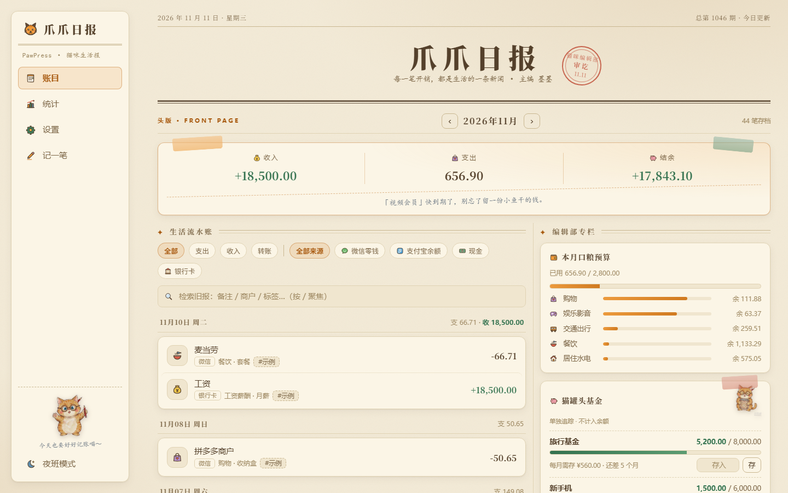
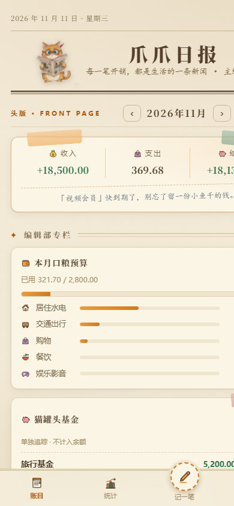
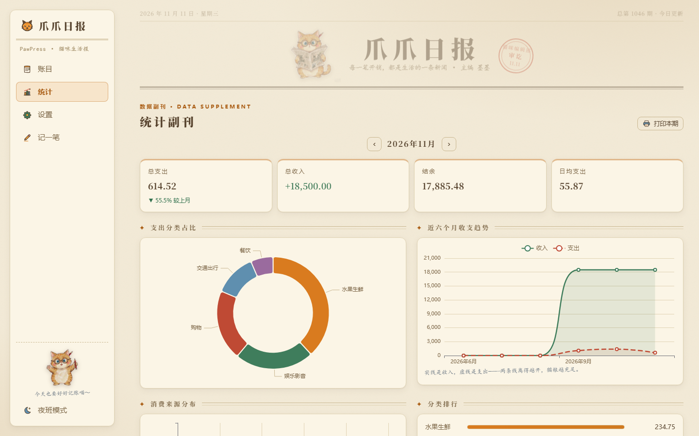
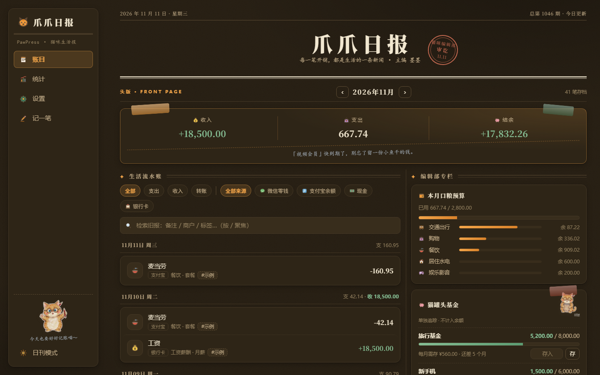
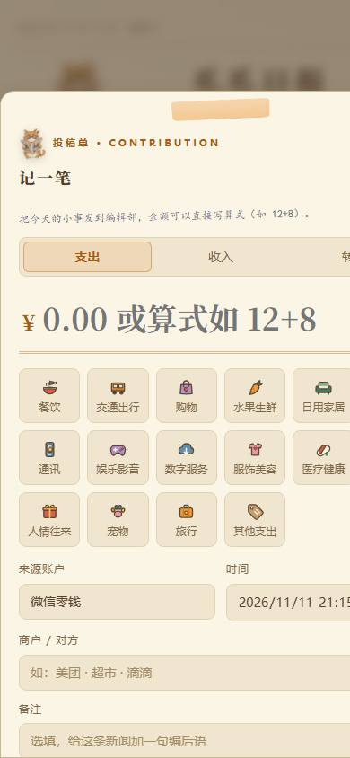
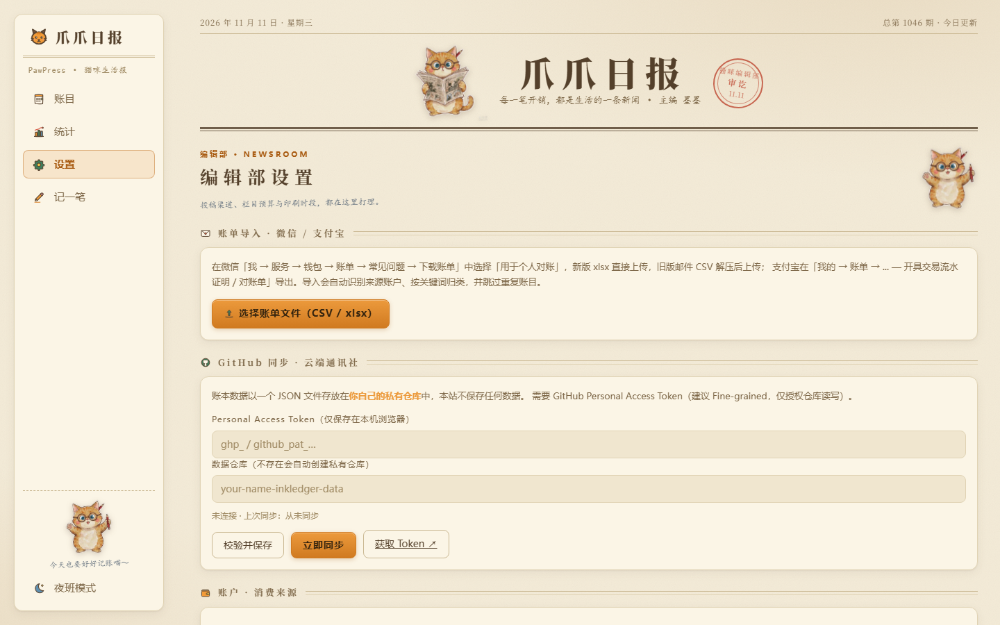

<div align="center">

# 爪爪日报 · PawPress

**一份「卡通小猫 × 复古报刊编辑部」风格的猫咪生活报式记账应用 —— 无后端、无数据库、数据完全自持**

米白旧报纸 · 手绘多彩图标 · PWA · 微信 / 支付宝账单导入 · GitHub 私有仓库同步 · 自动归类

[](https://github.com/rwzdk/inkledger/stargazers)
[](./README.md#-更新日志)
[](./LICENSE)
[](https://vuejs.org/)
[](https://vitejs.dev/)
[](https://github.com/rwzdk/inkledger/actions)

</div>

---

## 这是什么

爪爪日报（PawPress）是一个**部署在哪里都能跑**的个人记账本。它把每天的收支排成一份**猫咪生活报**：头版是本月收支结余，副刊是统计图表，记一笔是向编辑部投稿，手绘小猫主编「墨墨」替你审稿——

- **纯静态**：构建产物只是一堆 HTML/JS/CSS，任何静态托管（Qoder Sites、Cloudflare Pages、Vercel、GitHub Pages…）免费部署，永不担心服务停机
- **数据自持**：账单保存在浏览器本地，可随时同步到你自己的 **GitHub 私有仓库**——不经过任何第三方服务器，天然带版本历史
- **微信 / 支付宝账单导入**：上传官方导出的账单 CSV，自动识别消费来源账户、按关键词自动归类、按交易单号去重
- **离线可用**：PWA + Service Worker，记账这件事不需要网络

> 🌐 **在线体验**：[rwzdk.github.io/inkledger/#demo](https://rwzdk.github.io/inkledger/#demo)（`#demo` 会自动载入示例数据；深链 `#stats` / `#settings` / `#add` / `#light` / `#dark` 可直达对应视图或主题）
>
> 另有 Qoder Sites 私有部署：`inkledger-j8vzdjdlheu.qoder.website`（需 Qoder 账号登录访问）

## 界面预览

| 桌面端 · 日刊（头版） | 移动端 |
|:---:|:---:|
|  |  |
| **数据副刊** | **夜班主题** |
|  |  |
| **记一笔 · 投稿单** | **编辑部设置** |
|  |  |

## ✨ 功能特性

- 🗒️ **记账**：支出 / 收入 / 转账，二级语义清晰的账户体系（微信零钱、支付宝、现金、银行卡…即「消费来源」）
- 📥 **账单导入**：微信支付、支付宝官方导出的 CSV 一键导入；自动建户（按银行卡尾号识别同一账户）、关键词自动归类、交易单号去重、退款标记
- 📊 **统计分析**：分类占比环图、近六个月收支趋势、消费来源分布、分类排行与日均支出
- ☁️ **GitHub 同步**：Fine-grained PAT 授权，自动创建私有数据仓库，多端按 `updatedAt` 合并
- 🎨 **双主题**：日刊（默认）/ 夜班——日刊是米白旧报纸底纹 + 浅棕文字 + 橘黄墨绿点缀，夜班是编辑部台灯下的暖棕暗色；全站手绘多彩图标，报头与侧栏、空态、便签、投稿单、设置页统一为同一只手绘插画主编猫「墨墨」的多姿势形象
- 📱 **PWA**：可安装到手机桌面，Service Worker 离线访问
- 🔒 **隐私**：无统计、无追踪、无后端；Token 仅存于浏览器 localStorage

## 🚀 快速开始

### 本地开发

```bash
git clone https://github.com/rwzdk/inkledger.git
cd inkledger
pnpm install    # 或 npm install
pnpm dev        # http://localhost:5173
```

### 部署

爪爪日报是纯静态应用，`pnpm build` 后把 `dist/` 扔到任意静态托管即可。
**Qoder Sites / Cloudflare Pages / Vercel / Netlify / GitHub Pages** 的图文步骤见 [DEPLOY.md](./DEPLOY.md)。

[](https://vercel.com/new/clone?repository-url=https://github.com/rwzdk/inkledger)

## 📥 如何导出微信 / 支付宝账单

| 平台 | 路径 | 说明 |
|---|---|---|
| 微信 | 我 → 服务 → 钱包 → 账单 → 右上角「…」→ 导出账单记录 → 用于个人对账 | 新版直接生成 **xlsx**，旧版经邮箱发送 CSV（解压密码为身份证号）；两种都支持 |
| 支付宝 | 我的 → 账单 → 右上角「…」→ 开具交易流水 / 对账单 | 解压后得到 CSV |

导出后在爪爪日报「设置 → 微信 / 支付宝账单导入」上传即可。xlsx / CSV 自动识别；CSV 支持 UTF-8 与 GBK 编码；xlsx 内的 Excel 序列日期会自动转换。已用真实微信账单（134 笔）验证：导入笔数与金额和账单自述完全一致。

## ☁️ 数据同步与隐私

1. 在 [GitHub Settings → Developer settings](https://github.com/settings/tokens?type=beta) 创建 **Fine-grained Token**（只需仓库读写权限，建议设置有效期）
2. 在爪爪日报「设置 → GitHub 同步」粘贴 Token 并校验
3. 点击「立即同步」——首次会自动创建 `<你的用户名>-inkledger-data` **私有仓库**，账本以 `data.json` 存于其中

Token 与数据都不会离开你的浏览器到任何第三方服务器（仅 GitHub 官方 API）。合并策略为按条目 `updatedAt` 新者胜。

## 🧱 技术栈

- [Vue 3](https://vuejs.org/)（Composition API，无 UI 框架依赖，样式手写设计系统）
- [Vite 6](https://vitejs.dev/)
- [ECharts 5](https://echarts.apache.org/)（按需引入 Tree-shaking）
- 原生 PWA（手写 Service Worker）

账单导入解析器为纯函数实现，测试覆盖见 `tests/`（`pnpm test`）。

## 🗺 Roadmap

- [x] 预算管理与超支提醒（v1.3 分类预算 · v1.5 信封结转）
- [x] 数据报表导出（v1.4 账目 CSV · v1.6 一键打印报告）
- [ ] 账单快照识别（截图 OCR）
- [ ] WebDAV / S3 同步端点
- [ ] PDF 报表直出（现经浏览器打印另存为 PDF）

## 🤝 贡献

欢迎 Issue 与 PR。提交前请跑 `pnpm test && pnpm build`。

## 📝 更新日志

### v1.8.0（2026-11-11）

- **change**：项目更名 **「墨账日报 InkLedger」→「爪爪日报 PawPress」**（爪印 × 报刊）。仅改展示层品牌与文档；内部标识（localStorage key、导出文件名、GitHub 数据仓库名、npm 包名、仓库 slug）保持不变，老数据零迁移
- **style**：**全站猫咪统一为同一只手绘插画主编猫「墨墨」的多姿势形象**——读报（报头 / 投稿单）、蜷睡（空态）、挥手（侧栏 / 便签 / 设置 / 统计署名）、抱存钱罐（储蓄目标），替代原简笔 SVG 大头猫；`CatArt` 组件改为透明 WebP 插画
- **style**：**favicon 与 PWA 全套图标重制**——以手绘主编猫合成米白报纸圆角徽章，输出 `favicon.png` / `icon-192.png` / `icon-512.png`（512 为 maskable 铺满安全区），移除旧 SVG 图标
- **perf**：5 张猫插画统一转 **alpha WebP**（总约 268KB，较 PNG 约 1.1MB 大幅瘦身），经 Vite 构建期资源引用，任意子目录部署可离线加载
- PWA 缓存版本升至 `pawpress-v1.8.0`；全部功能、快捷键、深链、打印、数据格式零迁移兼容

### v1.7.1（2026-11-11）

- **style**：报头主编猫「墨墨」升级为**完整全身手绘插画**——AI 手绘水彩生成后抠成透明贴纸（橘猫主编戴圆框眼镜、端坐捧读旧报纸、尾巴卷在身侧、耳后别红铅笔），替代原简笔 SVG 猫；日刊 / 夜班 / 移动端报头同步换装
- **feat**：新增 `#dark` 深链，与 `#light` 对称，可直达夜班主题（可与 `#demo` / `#stats` 组合）
- **fix**：报头插画改走构建期资源引用（`new URL` 相对路径），任意子目录静态部署均可正确加载
- PWA 缓存版本升至 v1.7.1，报头插画加入离线外壳预缓存

### v1.7.0（2026-11-11）

- **style**：全站改版为**「卡通小猫 × 复古报刊编辑部」**——米白旧报纸底纹（SVG 噪点纸纹）、浅棕文字、橘黄与墨绿点缀；报头「墨账日报」+ 手绘主编猫 + 日期期号邮戳，首页改「头版」双栏（左生活流水账 / 右编辑部专栏），统计页改「数据副刊」，设置页改「编辑部」，记一笔改「投稿单」
- **style**：**全部图标重绘为手绘多彩贴纸风**（固定彩色填充 + 深棕描边、微歪手绘线条），新增猫 / 爪印 / 铃铛 / 日历 / 同步 / 上传下载 / 邮票等 20+ 键；分类图标点选器同步换装；旧数据自定义图标与 emoji 仍兼容
- **feat**：**手绘小猫插画** `CatArt`——报头读报主编猫、空态蜷睡猫、侧栏 / 便签探头猫三形态；favicon 与 PWA 全套图标换为猫报 logo
- **style**：新增胶带、邮票齿孔、铅笔批注（楷体）、报纸双线分栏等报刊元素；图表色板改走 `--chart-1..8` 报刊色，随主题切换重渲染
- **change**：默认主题改为**日刊**（米白报纸），原夜墨 / 宣纸更名为**夜班 / 日刊**；夜班为编辑部台灯暖棕暗色
- **fix**：dev server 忽略编辑器原子写入的 `.tmpdir` 临时目录，避免 Windows 文件锁导致 watcher EBUSY 崩溃
- 全部功能、快捷键、深链、打印、数据格式零迁移兼容；PWA 缓存版本升至 v1.7

### v1.6.0（2026-10-26）

- **feat**：**自定义自动归类规则**（参考 Firefly III 规则引擎）——按顺序匹配商户/商品关键词,命中即归入指定分类,优先于分类自带关键词;账单导入与手动记一笔均生效,记一笔输入商户时未选分类会智能预选
- **feat**：统计页**一键打印报告**——隐藏交互组件,界面文字自动切换浅色打印配色(图表按当前主题原样输出)
- **feat**：**PWA 快捷方式 + URL 快速记账**——长按应用图标直达「记一笔」;支持 `?type=expense&amount=30&payee=xx&tag=a,b` 参数预填,可配合系统快捷指令秒记
- 规则数据随 GitHub 同步与 JSON 备份;全部纯前端实现

### v1.5.0（2026-10-26）

- **feat**：**信封式预算结转**（参考 Actual Budget）——分类预算可开启「结转」，未用完额度滚入下月、超支扣减后续信封；额度修改不重置基线，首页预算卡实时按信封口径展示
- **feat**：**储蓄目标**（参考 Firefly III 存钱罐）——目标进度条、按目标月倒推月存额、首页快捷存入；纯进度追踪，不影响账户余额与总资产
- **feat**：**资产走势**（参考 Sossoldi / Wealthfolio）——统计页新增月度净值曲线与当前总资产（按账户余额推算，含信用卡负债）
- **feat**：**标签增强**——统计页新增标签排行（多标签分别计入并注明），记一笔标签输入自动补全（高频 Top 20）
- 全部纯前端实现；目标数据随 GitHub 同步与 JSON 备份；老数据零迁移兼容

### v1.4.0（2026-10-26）

- **feat**：**周期账单 / 订阅管理**——房租、会员、话费等固定扣费设置周期（每月 / 每季 / 每年）与扣费日，首页「近期账单」到期提醒（逾期标红），点「缴账」一键入账并自动顺延；每月固定支出自动折算
- **feat**：统计新增**年度总览**——年份切换、年度总收支 / 结余 / 月均支出与 12 个月收支柱状图
- **feat**：数据管理新增**导出账目 CSV**（UTF-8 + BOM，Excel 直接打开不乱码）
- **feat**：键盘快捷键——`N` 记一笔、`/` 聚焦搜索、`Esc` 关闭弹层
- 周期账单数据随 GitHub 同步与备份导出，纯前端实现，不影响静态部署

### v1.3.0（2026-10-26）

- **feat**：**月度分类预算**——设置中为支出分类设定每月额度，首页新增预算执行卡片（总额度进度 + 各分类余/超提示，超支标红），预算数据随 GitHub 同步与备份导出
- **feat**：统计总支出新增**环比**（较上月 ±%，支升红 / 支降绿）
- **feat**：账目列表新增**类型筛选**（全部 / 支出 / 收入 / 转账）
- **feat**：记一笔金额框支持**算式输入**（如 `12+8`、`(30+6)/2`，失焦自动求值回显）
- **style**：应用图标全新设计——金字「墨」+ 账线落墨点，替换 favicon 与 PWA 全套图标

### v1.2.0（2026-10-25）

- **feat**：全站图标升级为 **Lucide 线性图标库**（统一 24×24 描边风格、颜色跟随主题）——导航、统计、记一笔、设置、主题切换、搜索、转账及全部分类与账户图标不再依赖 emoji，跨平台显示一致
- **feat**：新增图标注册表 `src/lib/icons.js` 与 `AppIcon` / `DataIcon` 组件；分类编辑器改为**图标点选器**（21 个语义图标）
- **compat**：旧数据兼容——已保存的分类若仍是默认 emoji 图标会自动升级为线性图标，自定义图标保持不变

### v1.1.0（2026-10-25）

- **feat**：支持微信新版 **xlsx 账单**直接导入——零依赖解析器（原生 `DecompressionStream` 解 zip + 正则解析 sheet XML），按文件魔数与 CSV 自动分流
- **feat**：适配真实账单数据特征——Excel 序列日期转换、`"/"` 空值清洗、空支付方式的红包收入默认记入零钱、商户名空白修剪
- **test**：新增匿名化 xlsx 夹具与 13 项断言，并以真实账单（134 笔）完成端到端验证（笔数与金额和账单自述一致）

### v1.0.1（2026-10-25）

GUI 黑盒功能测试后的问题修复：

- **fix**：点击已有账目无法打开编辑弹层，导致编辑/删除不可用——`TxEditor` 对 Vue 响应式对象使用 `structuredClone` 抛 `DataCloneError`，改为 JSON 深拷贝
- **fix**：移动端（<900px）桌面侧边栏未隐藏、堆叠在页面顶部——补充 `.sidenav` 基础 `display:none` 规则

### v1.0.0（2026-10-25）

首个版本：记账（支出/收入/转账）、微信/支付宝账单导入、统计图表、GitHub 私有仓库同步、夜墨/宣纸双主题、PWA 离线可用。

## 📄 许可证

[MIT](./LICENSE) © rwzdk
